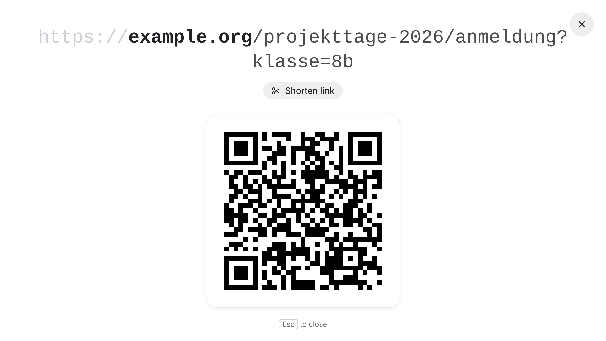

# QRbeam

A small browser extension for Firefox and Chromium-based browsers. Click the QR icon next to the address bar and the current tab is covered by one large address and QR code, readable from the back row of a classroom.

**Website and downloads: https://wi-wissen.github.io/qrbeam/**



## Features

- **One click or `Alt+Shift+Q`** opens the overlay, `Esc` closes it.
- **Large address, quiet scheme:** `https://` is pale grey, the domain is bold, the QR code fills the rest of the screen.
- **Clean links:** tracking parameters (`utm_*`, `fbclid`, `gclid`, `si`, …) are removed. Amazon product pages become `amazon.de/dp/<ASIN>`, YouTube videos become `youtu.be/<id>` (time stamps and playlists are kept).
- **Shorten link:** one button turns the address into an [is.gd](https://is.gd) link. The QR code follows, the full address stays visible in small print.
- **Looks like part of the browser:** system font, system colors, light and dark mode.
- **Private by default:** no tracking, no analytics. Nothing leaves your computer unless you press “Shorten link”; then only the shown address is sent to is.gd.

## Install

QRbeam is not in the browser stores. Install it from the [GitHub releases](https://github.com/wi-wissen/qrbeam/releases/latest).

### Firefox

1. Open https://wi-wissen.github.io/qrbeam/ and click **Add to Firefox**.
2. Firefox asks whether the site may install add-ons. Click **Continue to installation**, then **Add**.
3. The QR icon appears inside the address bar on every web page.

The add-on is signed by Mozilla and updates itself. Alternatively, download `qrbeam-firefox.xpi` from the releases and drag it into a Firefox window.

### Chrome, Edge, Brave, Vivaldi, Opera

1. Download [`qrbeam-chrome.zip`](https://github.com/wi-wissen/qrbeam/releases/latest/download/qrbeam-chrome.zip) and unzip it into a folder you keep, for example `Documents/QRbeam`.
2. Open `chrome://extensions` (Edge: `edge://extensions`, Brave: `brave://extensions`, Opera: `opera://extensions`).
3. Turn on **Developer mode**.
4. Click **Load unpacked** and select the folder.
5. Click the puzzle icon in the toolbar and pin **QRbeam**.

Chromium browsers do not allow extensions inside the address bar, so the icon sits right next to it. Extensions loaded this way do not update automatically: unzip a new version into the same folder and click the reload arrow on the extensions page.

## Usage

| Action | How |
| --- | --- |
| Show the overlay | Click the QR icon or press `Alt+Shift+Q` |
| Shorten the link | Click **Shorten link** below the address |
| Back to the long address | Click **Undo** |
| Close | `Esc`, the × button, or click the icon again |

Change the shortcut in Firefox under `about:addons` → gear menu → **Manage Extension Shortcuts**, in Chrome under `chrome://extensions/shortcuts`.

On pages where browsers forbid extensions (settings pages, the extension stores, some PDF viewers) QRbeam opens the same view in a new tab.

## Privacy

- QRbeam reads the address of the current tab only when you click its icon or press the shortcut.
- The QR code is generated locally.
- Pressing **Shorten link** sends the shown address to [is.gd](https://is.gd/privacy.php). Nothing else is ever sent anywhere.
- Firefox asks for permission the first time you press **Shorten link** (data category “browsing activity”). Installing QRbeam itself asks for no data permissions. You can withdraw the permission under `about:addons` → QRbeam → **Permissions**.
- Permissions: `activeTab`, `scripting`, `storage` (to remember short links for the session), and in Chromium `offscreen` (to match the toolbar icon to light or dark mode).

## Development

```bash
npm ci
npm test               # unit tests for the link cleaner
npm run build          # dist/chrome, dist/firefox and zip files
npm run lint           # Mozilla's add-on linter on the Firefox build
```

Load `dist/chrome` via **Load unpacked**, or run `npx web-ext run --source-dir dist/firefox` for a temporary Firefox profile.

Project layout:

```
src/                 extension source (plain JavaScript, no framework)
  background.js      icon click, shortcut, is.gd requests
  overlay.js         the projector view (shadow DOM)
  clean.js           tracking parameter rules
  view.html          fallback page for tabs that block extensions
  consent.html       Firefox: one-time permission for link shortening
  vendor/qrcode.js   QR code generator by Kazuhiko Arase (MIT)
manifest/            base manifest plus Chrome and Firefox additions
scripts/             build, icons, screenshots, Pages data
site/                GitHub Pages website
```

Tracking rules live in `src/clean.js`. Add a parameter there and a test in `test/clean.test.mjs`.

`npm run icons` and `npm run screenshots` regenerate the icons and the website previews; both need Playwright with Chromium.

## Releasing

1. Go to **Actions → Release → Run workflow**.
2. Enter a version such as `1.0.0` and start it.

The workflow builds from the current `main`, signs the Firefox package with Mozilla, creates the GitHub release with `qrbeam-chrome.zip` and `qrbeam-firefox.xpi`, and updates the website and the Firefox update feed.

## Maintainers: Firefox signing setup

Firefox only installs add-ons signed by Mozilla. QRbeam is signed as an *unlisted* add-on: it never appears on addons.mozilla.org, and signing runs automatically in the release workflow.

One-time setup:

1. Create a Mozilla account at https://addons.mozilla.org (top right: **Log in**).
2. Open https://addons.mozilla.org/developers/addon/api/key/, accept the developer agreement and enable two-factor authentication if asked.
3. Click **Generate new credentials** and copy both values. The secret is shown only once.
   - JWT issuer, looks like `user:12345678:123`
   - JWT secret
4. In this repository go to **Settings → Secrets and variables → Actions** and add:
   - `AMO_JWT_ISSUER`: the JWT issuer
   - `AMO_JWT_SECRET`: the JWT secret
5. Under **Settings → Pages**, set **Source** to **GitHub Actions**.

The add-on ID `qrbeam@wi-wissen.github.io` must never change, otherwise installed copies stop receiving updates.

## License

[MIT](LICENSE). Includes [qrcode-generator](https://github.com/kazuhikoarase/qrcode-generator) by Kazuhiko Arase (MIT). “QR Code” is a registered trademark of DENSO WAVE INCORPORATED.
